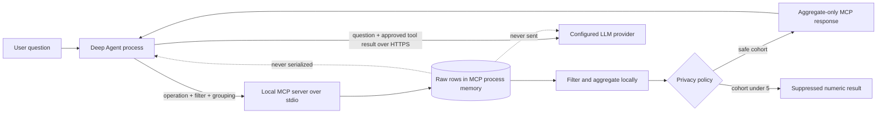

# Deep Agents: Private Analytics over MCP

This project demonstrates how an AI agent can answer useful questions about tabular
data without giving the language model the underlying rows. A local FastMCP process
owns and analyzes the raw data. The Deep Agent receives only approved aggregates,
schema metadata, query metadata, and one fixed synthetic example.

The server exposes exactly **34 deterministic, read-only table tools** through MCP over
stdio. Every tool supports counts, numeric aggregates, grouping, and exact-match
filters while enforcing a minimum numeric cohort size of five.

> [!IMPORTANT]
> This is an **aggregate-only** design, not a claim that no information reaches the
> model. Approved aggregates, schema metadata, and a synthetic example reach the LLM.
> Raw rows, real names, and source identifiers do not.


The screenshot is generated from a real MCP tool call. Reproduce the underlying check
with `python scripts/capture-privacy-evidence.py`; it requires no API key.

## The Privacy Boundary



There are two different transports:

1. **MCP transport:** The agent launches the MCP server as a child process and uses
   stdin/stdout. The server does not make a network call to return tool data.
2. **Model transport:** The agent calls the configured OpenAI-compatible provider over
   HTTPS. The model request can include the user question and the aggregate-only MCP
   result, but not the raw source rows.

The server boundary is the primary control. The system prompt is defense in depth and
guides the model to refuse row-level requests, but privacy does not depend on the model
obeying that prompt.

## What Crosses the Boundary

| Item | Agent/LLM receives it? | Notes |
| --- | --- | --- |
| Raw `rows` collection | No | Exists only inside the MCP server process |
| Real record ID or name | No | Never copied into a tool response |
| Schema and metric name | Yes | Needed to interpret aggregates |
| Allowed categories/statuses | Yes | Metadata, not observed row values |
| Synthetic example | Yes | Fixed `EXAMPLE-0000`; never sampled from raw rows |
| Count | Yes | Counts are intentionally permitted |
| Sum/average/minimum/maximum | Sometimes | Suppressed when the matching cohort has fewer than five rows |
| Grouped numeric result | Sometimes | Each group smaller than five is independently suppressed |
| User question | Yes | Sent to the selected model provider when the agent runs |

An actual safe MCP response has this shape:

```json
{
  "title": "Products",
  "privacy": {
    "raw_rows_shared": false,
    "processing_location": "MCP server",
    "example_is_synthetic": true,
    "minimum_cohort_size": 5
  },
  "schema": {
    "columns": ["id", "name", "category", "status", "price", "date"],
    "numeric_metric": "price"
  },
  "example_row": {
    "id": "EXAMPLE-0000",
    "name": "Example Product",
    "price": 123.45
  },
  "query": {
    "operation": "group_average",
    "group_by": "category",
    "seed": 7
  },
  "result": [
    {"category": "Hardware", "average": 2346.87},
    {"category": "Service", "average": 2448.82},
    {"category": "Software", "average": 2584.67}
  ]
}
```

Notice that `schema.columns` describes an `id` and `name` column, but the response does
not contain any real ID or name values. The example values are hard-coded synthetic
values used only to teach the model the record shape.

## Query Examples

All tools accept the same interface:

| Parameter | Values |
| --- | --- |
| `operation` | `overview`, `count`, `sum`, `average`, `minimum`, `maximum`, `group_count`, `group_sum`, `group_average` |
| `group_by` | `category`, `status`, `date` |
| `filter_field` | `category`, `status`, `date` |
| `filter_value` | Case-insensitive exact match |
| `seed` | Integer controlling deterministic demo generation |

Safe questions include:

```text
Compare average product price by category.
How many products are backordered?
Which sales region has the highest average revenue?
Compare active and cancelled subscription counts.
Give an overview of support tickets.
```

For example, "How many products are backordered?" becomes:

```json
{
  "operation": "count",
  "filter_field": "status",
  "filter_value": "Backorder"
}
```

A row-level request such as "Give me the real name and ID of the most expensive
customer" is refused. The agent can instead call `get_customers` with `maximum` and
report the highest `lifetime_value` without revealing which customer produced it.

If a numeric filter matches fewer than five rows, the response is:

```json
{
  "suppressed": true,
  "reason": "Fewer than 5 records match the query"
}
```

## The 34 Tools

`get_people`, `get_customers`, `get_employees`, `get_products`, `get_orders`,
`get_sales`, `get_inventory`, `get_shipments`, `get_suppliers`, `get_weather`,
`get_transactions`, `get_budgets`, `get_invoices`, `get_support_tickets`,
`get_projects`, `get_tasks`, `get_events`, `get_books`, `get_movies`, `get_teams`,
`get_matches`, `get_flights`, `get_hotels`, `get_devices`, `get_sensors`,
`get_web_metrics`, `get_campaigns`, `get_leads`, `get_subscriptions`, `get_payments`,
`get_restaurants`, `get_recipes`, `get_courses`, and `get_students`.

## Setup

Python 3.11 or newer is required.

```powershell
py -m venv .venv
.venv\Scripts\Activate.ps1
python -m pip install -e ".[dev]"
```

Verify the privacy contract without any model credential:

```powershell
table-mcp-smoke
python scripts/capture-privacy-evidence.py
pytest -q
```

The smoke test starts a real stdio MCP session, confirms that exactly 34 tools are
advertised, parses the returned JSON object, recursively rejects any `rows` key, and
requires the explicit synthetic-example and no-raw-rows guarantees.

## Model Provider

Use the secure setup helper. It prompts for the key without echoing it, discovers model
IDs, and writes only to the ignored local `.env` file:

```powershell
.\scripts\configure-provider.ps1 -BaseUrl "https://jianzhile.vip/v1"
```

Then run:

```powershell
table-deep-agent "Compare average product price by category."
```

The provider must support the OpenAI Chat Completions API. This project explicitly
uses Chat Completions rather than the Responses API for compatibility. Never put an
API key in a command argument, source file, screenshot, issue, or chat. A key pasted
into any of those locations must be revoked and replaced before use.

## Reproducing the Evidence

The evidence utility launches the server using the current Python interpreter, sends
raw MCP JSON-RPC messages over stdin, calls `get_products`, parses the returned content,
and prints only a sanitized summary. On Windows it also queries
`Get-NetTCPConnection -OwningProcess <pid>` while the MCP server is alive.

Expected evidence:

```json
{
  "mcp_transport": "stdio",
  "server_tcp_connections": 0,
  "response_top_level_keys": [
    "title", "privacy", "schema", "example_row", "query", "result"
  ],
  "raw_rows_shared": false,
  "example_is_synthetic": true
}
```

Zero TCP connections apply to the **MCP server process during this local tool call**.
The separate agent process makes an HTTPS connection when it sends the user question
and approved aggregate result to the configured model provider.

## QA Coverage

The test suite covers deterministic generation, exactly 34 unique tools, invalid
limits, absence of raw IDs and names, grouping, filtering, minimum cohort suppression,
recursive MCP payload inspection, and the row-level refusal prompt. The full QA pass
also exercised 578 combinations across all tools, operations, groupings, and filters.

```powershell
.venv\Scripts\python.exe -m pytest -q
.venv\Scripts\python.exe -m compileall -q src tests scripts
.venv\Scripts\python.exe -m pip check
```

## Limitations

This is a privacy-preserving architecture demonstration, not a complete production
privacy system. Counts remain visible, and repeated or overlapping aggregate queries
can support inference attacks. A production deployment should add authentication,
authorization, query auditing, rate limits, contribution bounds, query budgets,
differential privacy where appropriate, provider retention controls, and an independent
security review.

See [docs/privacy-architecture.md](docs/privacy-architecture.md) for the detailed threat
model and implementation rationale. VS Code can launch the local server using
[.vscode/mcp.json](.vscode/mcp.json).
