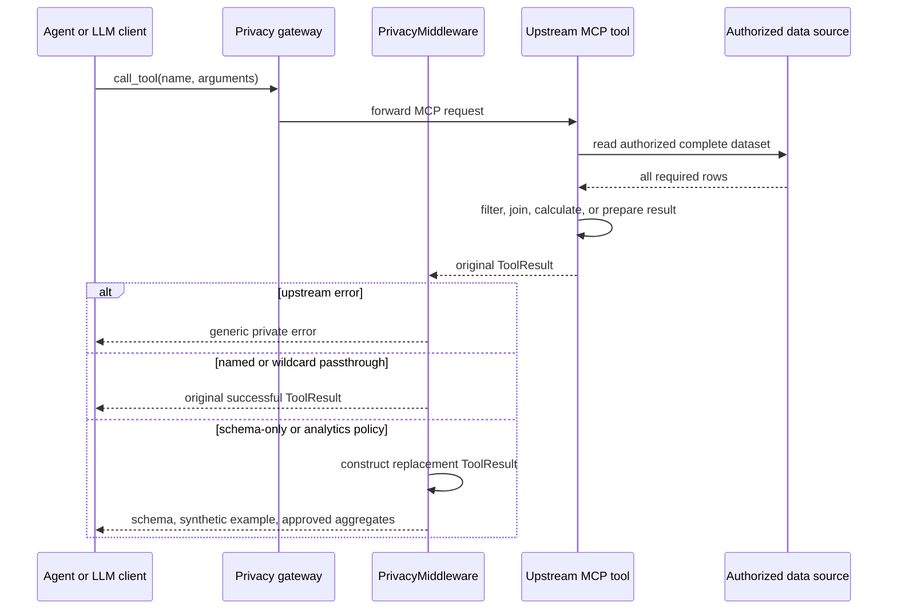
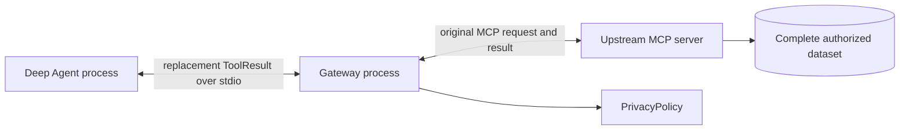

# Implementation Guide: Full-Data MCP Tools with LLM-Safe Results

| Field | Value |
|---|---|
| Audience | AI platform, application security, MCP service owners |
| Pattern | Full-data tool execution with post-execution result minimization |
| Reference package | `deepagents-mcp-privacy` 0.3.0 |
| Default disclosure | Schema, inferred types, synthetic examples |
| Middleware API | `fastmcp.server.middleware.middleware.Middleware` |
| Interception hook | `Middleware.on_call_tool()` |

## Executive summary

An MCP tool can use the complete source dataset without sending that dataset to an
LLM. The business tool runs first, inside the upstream MCP trust zone, and can read,
filter, join, or calculate over every authorized record. A FastMCP result middleware
then intercepts the successful `ToolResult` and constructs a different response for
the MCP client. Under the default policy, that replacement contains only schema,
inferred types, synthetic examples, and explicit privacy metadata.

This is a runtime boundary, not a prompt instruction. The agent and model cannot use
raw values that were never copied into the gateway-to-agent response. The gateway does
briefly receive the upstream result, so it belongs inside the trusted data-processing
zone and must be isolated and prevented from logging raw payloads.

## Required distinction

| Requirement | Correct mode | What the agent or LLM can receive |
|---|---|---|
| Tool must analyze all rows, model needs only shape | Schema-only default | Schema, types, synthetic example; no observed rows |
| Model needs approved counts or aggregates | Explicit analytics policy | Approved derived values, subject to cohort controls |
| Model genuinely needs the complete tool result | Selected passthrough | Original successful `ToolResult` for named tools |
| Every tool on an approved server may disclose results | Wildcard passthrough | Original successful results for all tools |

"The tool needs the whole data" does not by itself require passthrough. Tools normally
need source-system access to perform useful work. Passthrough is required only when the
agent or model also needs the complete returned records or content.

## Runtime sequence



The critical ordering is `await call_next(context)` followed by response replacement.
`call_next` executes the upstream tool with its normal permissions and data access.
The middleware does not alter tool inputs or constrain internal computation; it
controls only what crosses the outbound MCP result boundary.

## How this library implements the pattern

### 1. Process placement

`create_private_mcp_client()` rewrites each original MCP connection into a stdio
connection that launches `python -m deepagents_mcp_privacy.runner`. The original
connection and policy are base64-encoded JSON environment values. The runner creates
a FastMCP proxy for the upstream connection and attaches `PrivacyMiddleware`.



For stdio upstreams, the gateway launches the upstream server as a descendant process.
For HTTP upstreams, the gateway connects to the configured MCP endpoint. In both cases,
the gateway is the first component outside the upstream server that can observe the
original result.

### 2. Exact middleware

The package subclasses:

```python
from fastmcp.server.middleware.middleware import Middleware
```

It implements:

```python
async def on_call_tool(self, context, call_next):
    result = await call_next(context)
```

The production implementation is `PrivacyMiddleware` in
`src/deepagents_mcp_privacy/privacy.py`. Its decision order is significant:

1. Execute the upstream tool through `call_next(context)`.
2. Replace every upstream error with a generic error.
3. Return the original successful result only when the tool name is approved for
   passthrough.
4. Otherwise read `ToolResult.structured_content`, or fall back to text content.
5. Run `sanitize_value()` to infer structure and create synthetic values.
6. Construct a new `ToolResult` with sanitized text and structured content and empty
   metadata.
7. Fail closed with a generic error if middleware processing raises an exception.

This ordering prevents wildcard passthrough from exposing exception messages and
prevents original content blocks or metadata from surviving schema-only mode.

### 3. Library usage

```python
from deepagents import create_deep_agent
from deepagents_mcp_privacy import create_private_mcp_client

connections = {
    "customer-analytics": {
        "transport": "stdio",
        "command": "python",
        "args": ["-m", "customer_analytics.server"],
    }
}

client = create_private_mcp_client(connections)
tools = await client.get_tools()
agent = create_deep_agent(model=model, tools=tools)
```

The upstream tools still access all records authorized to the MCP server. No code
change is required inside those tools. The LLM-facing adapter receives the replacement
result generated by the gateway.

For approved full-result disclosure:

```python
client = create_private_mcp_client(
    connections,
    passthrough_tools=("get_public_catalog",),
)
```

Use `passthrough_tools=("*",)` only when the complete server catalog and future catalog
changes are governed as an approved disclosure surface.

## Equivalent implementation without this library

Teams can implement the same boundary directly with FastMCP. The minimum design needs
a proxy, an `on_call_tool` result middleware, a fail-closed sanitizer, and process
placement before the agent-side MCP client.

```python
import json

import mcp.types as mt
from fastmcp.server import create_proxy
from fastmcp.server.middleware.middleware import CallNext, Middleware, MiddlewareContext
from fastmcp.tools.base import ToolResult


class ResultPrivacyMiddleware(Middleware):
    def __init__(self, passthrough_tools: frozenset[str] = frozenset()) -> None:
        self.passthrough_tools = passthrough_tools

    async def on_call_tool(
        self,
        context: MiddlewareContext[mt.CallToolRequestParams],
        call_next: CallNext[mt.CallToolRequestParams, ToolResult],
    ) -> ToolResult:
        try:
            original = await call_next(context)
            if original.is_error:
                return private_error()
            if "*" in self.passthrough_tools or context.message.name in self.passthrough_tools:
                return original

            value = original.structured_content
            if value is None:
                text_blocks = [
                    block.text
                    for block in original.content
                    if isinstance(block, mt.TextContent)
                ]
                value = text_blocks[0] if len(text_blocks) == 1 else text_blocks

            safe = sanitize_for_llm(value)
            encoded = json.dumps(safe, separators=(",", ":"))
            return ToolResult(
                content=[mt.TextContent(type="text", text=encoded)],
                structured_content=safe,
                meta={},
            )
        except Exception:
            return private_error()


def private_error() -> ToolResult:
    safe = {"error": "Upstream tool call failed; details withheld"}
    return ToolResult(
        content=[mt.TextContent(type="text", text=json.dumps(safe))],
        structured_content=safe,
        meta={},
        is_error=True,
    )


upstream = {
    "mcpServers": {
        "source": {
            "transport": "stdio",
            "command": "python",
            "args": ["-m", "customer_analytics.server"],
        }
    }
}
gateway = create_proxy(upstream, name="Private MCP Gateway")
gateway.add_middleware(ResultPrivacyMiddleware())
gateway.run(transport="stdio")
```

`sanitize_for_llm()` is intentionally not presented as a one-line redaction function.
A production implementation must recursively parse and replace supported structures,
bound depth, detect cycles, handle value-like mapping keys, suppress small groups,
withhold arbitrary text and unsupported content, and never include source values in
errors. The package's `sanitize_value()` provides that tested policy engine.

### Agent-side connection without the package

The agent must connect to the gateway command, not directly to the upstream server:

```python
from langchain_mcp_adapters.client import MultiServerMCPClient

client = MultiServerMCPClient(
    {
        "customer-analytics": {
            "transport": "stdio",
            "command": "python",
            "args": ["private_gateway.py"],
        }
    }
)
```

Wrapping LangChain tool objects after `MultiServerMCPClient.get_tools()` is not
equivalent. At that point the raw MCP response may already exist in the agent process,
callbacks, traces, or exception paths. The replacement must occur in the MCP gateway
before the agent-side client receives the response.

## Sanitizer requirements

| Input or failure mode | Required behavior |
|---|---|
| List of row mappings | Expose field names and types; create fixed synthetic row |
| Nested mappings and arrays | Recursively expose shape without observed scalar values |
| JSON encoded as text | Parse, then sanitize as structured content |
| Arbitrary text | Withhold unless a reviewed domain transformer exists |
| Dynamic keys containing values | Replace keys with deterministic synthetic names |
| Errors | Return a constant message with no original detail or metadata |
| Images, audio, resources, mixed blocks | Withhold unless a specific safe transformation exists |
| Cyclic or deeply nested values | Stop traversal and return a withheld marker |
| Unknown or hostile containers | Fail closed; do not stringify the object |
| Counts and aggregates | Disabled by default; suppress cohorts below policy threshold |

Never sanitize by regular expression alone, truncate raw payloads, stringify unknown
objects, or ask the LLM to ignore sensitive fields. Those approaches still transfer
observed values across the boundary or create unbounded bypass paths.

## Verification pattern

A useful test must observe both sides of the boundary. The upstream tool records that
it processed the complete synthetic fixture. The client result is then checked for a
schema and synthetic example, while every fixture canary is asserted absent.

The repository test
`test_tool_processes_whole_dataset_while_llm_sees_only_synthetic_sample` proves:

1. The upstream tool received three complete rows and computed the correct total.
2. The client-facing `structured_content` declares `raw_data_shared: false`.
3. The client sees the expected columns and a fixed synthetic example.
4. No source identifier or numeric canary appears in the serialized response.

Additional mandatory tests are:

| Test | Expected result |
|---|---|
| Neighboring unapproved tool | Remains schema-only when another tool is passthrough |
| Wildcard successful call | Original result is preserved |
| Wildcard upstream error | Original error detail is absent |
| Gateway subprocess | Policy survives serialization and process launch |
| Plain text and binary content | Withheld by default |
| Cycles, excessive depth, hostile objects | Generic safe replacement |
| Logs and traces | No raw response payloads at any layer |

## Security and operational controls

1. Run the gateway in the same protected data zone as the upstream service.
2. Deny unnecessary gateway filesystem access and outbound network access.
3. Disable request, response, exception, callback, and tracing payload capture.
4. Authenticate and authorize inside the upstream tool; middleware is not row-level
   authorization.
5. Keep schema-only as the default and store exceptions in a reviewed policy manifest.
6. Bind approvals to server identity plus tool name to avoid cross-server name
   collisions.
7. Gate wildcard mode on server catalog review and fail deployment on catalog drift.
8. Test field names and descriptions because schema metadata can itself be sensitive.
9. Record policy version and decision outcome without recording source content.
10. Re-run dual-perspective canary tests on FastMCP, MCP SDK, or adapter upgrades.

## Assurance boundary

This pattern proves data minimization for tested response paths. It does not provide
formal anonymity, differential privacy, source authorization, or protection against a
compromised gateway. Raw values exist in the data source, upstream tool, and transiently
in gateway memory. Selected and wildcard passthrough deliberately move complete
successful results into the agent process and potentially the model-provider request.

The defensible claim is: under schema-only policy, tested observed values do not cross
the gateway-to-agent MCP result boundary, while the upstream tool retains access to all
data required for its authorized computation.

## Production architecture and resource gate

Deep Agents can be production-deployed, but its production positioning must not be
confused with automatic workload suitability. The harness combines an agent loop with
planning, filesystems, context offloading, subagents, memory, middleware, and optional
human approval. Each enabled capability increases the state, concurrency, latency,
resource, reliability, and security surface that the application team must own.

Choose the smallest orchestration model that meets the requirement:

| Workload | Preferred starting point |
|---|---|
| Bounded assistant with a small tool set | LangChain `create_agent` |
| Open-ended, multi-step work needing planning and context management | Deep Agents |
| Deterministic transitions, fixed approvals, or regulated execution | Explicit LangGraph workflow |

No universal CPU or RAM number is defensible. Capacity tests must use representative
short, median, worst-case, and adversarial tasks at expected and burst concurrency.
Capture both warm and cold runs and record:

1. Peak working set, CPU time, process count, and open handles by PID.
2. Input, output, and cached tokens plus context utilization and cost.
3. Serialized agent state, checkpoint, memory, file, and trace sizes.
4. Model, tool, queue, and end-to-end p50/p95/p99 latency.
5. Subagent depth and fan-out, parallel tool count, retries, and cancellations.
6. Downstream saturation, timeout behavior, recovery, and duplicate side effects.

Release limits should cover wall-clock time, tokens, model calls, tool calls, subagent
depth and fan-out, concurrency, payload bytes, memory, retries, and spend. Exhausting a
limit must cancel or fail safely rather than silently continue. Context summarization,
offloading, isolated subagents, progressive skill loading, and prompt caching can
reduce pressure, but they do not replace capacity testing.

## Privacy lifecycle outside the gateway

The result middleware is one control in a larger operating model. Production owners
must separately implement and verify:

| Control plane | Required control |
|---|---|
| Identity and source access | Authenticate every actor and authorize each row, operation, and tool invocation upstream. |
| MCP credentials | Validate token audience, prohibit token passthrough, use separate downstream credentials, and protect sessions. |
| Tenant isolation | Namespace checkpoints, stores, memory, files, vectors, caches, traces, and backups per tenant. |
| Execution safety | Allowlist tools, validate arguments and outputs, sandbox code/shell/filesystem access, restrict egress, and approve high-impact actions. |
| Data governance | Establish purpose, legal basis, classification, consent, minimization, residency, retention, deletion, and subject-rights workflows. |
| Providers and telemetry | Define encryption, regions, retention, training use, subprocessors, deletion, incident terms, and payload-free observability. |
| Assurance | Maintain policy owners, immutable audit events without source payloads, offline regressions, sampled online evaluations, red-team tests, and incident exercises. |

Prompt injection cannot be solved by system prompts alone. Treat tool, file, web, and
retrieved content as untrusted; segregate it from instructions; validate model outputs
deterministically; minimize tool authority; and require human approval for irreversible
or high-impact actions. Declarative subagents must receive the same restrictions
explicitly, and mutable middleware instance state must not be shared across concurrent
invocations.

The report at
[docs/assets/privacy-evidence.html](assets/privacy-evidence.html#production) contains
the production release checklist and links to the official Deep Agents documentation,
MCP security and authorization specifications, OWASP GenAI Top 10, and LangSmith
observability, evaluation, and deployment guidance used for this assessment.
