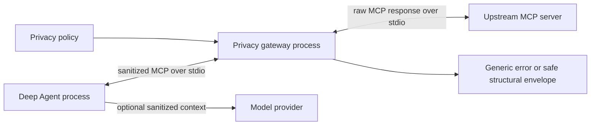

# Proposal: Privacy Gateway for Deep Agents MCP Integrations

| Field | Value |
|---|---|
| Status | Proposed for controlled pilot |
| Decision requested | Approve a non-production pilot and security review |
| Component | `deepagents-mcp-privacy` |
| Default policy | Schema-only, fail closed |
| Evidence date | Generated locally at validation time |
| Repository | DeepAgents-Data-Privacy |

The [IEEE-style structured-data privacy research paper](ieee-agentic-ai-data-privacy.md)
provides the record, schema, key, collection, aggregate, and propagation threat model,
control catalog, empirical claim boundary, and numbered research references.

## Executive summary

Deep Agents can call MCP tools that return tables, nested objects, infrastructure state, text, and errors. Passing those responses directly to an agent allows observed values to enter the agent process and potentially a model request. This proposal inserts a dedicated privacy gateway process between the agent and each upstream MCP server.

Under the default schema-only policy, the gateway replaces upstream results with field names, inferred types, synthetic examples, and privacy metadata. It withholds free text, replaces upstream error details, redacts value-like mapping keys, and does not copy unsupported content. Raw observed values remain in the upstream/gateway trust zone and do not cross the gateway-to-agent MCP boundary.

Approval is requested for a controlled pilot, not production certification. The pilot should validate business usefulness, field-name sensitivity, deployment controls, and policy ownership before broader adoption.

## Decision requested

Approve the following:

1. Run a time-boxed pilot against read-only, non-production MCP sources.
2. Require schema-only mode by default and explicit review for every policy relaxation.
3. Complete application security and privacy reviews before production use.
4. Assign platform ownership for gateway releases and data-owner responsibility for field allowlists.
5. Use the evidence harness in CI as a regression gate.

## Problem statement

MCP is a transport and tool protocol, not a data-loss-prevention boundary. An MCP server may return row-level records, identifiers, hostnames, IP addresses, account details, prose, or sensitive exception messages. Client-side prompt instructions are too late because the values have already entered the agent process. A reusable boundary must transform responses before LangChain, Deep Agents, tracing, or model-provider code can observe them.

## Proposed architecture



### Trust boundaries

| Zone | May contain raw observed values | Notes |
|---|---:|---|
| Upstream MCP server | Yes | Source system boundary |
| Privacy gateway process | Yes, transiently | Sanitization occurs here |
| Deep Agent process | No under validated schema-only paths | Receives replacement `ToolResult` |
| Model provider | No raw MCP values under validated schema-only paths | User prompts and field names may still be visible |

### Precise privacy claim

For the validated response paths and default policy, raw observed values and rows do not cross the gateway-to-agent MCP boundary. This does **not** mean that no data is sent. Tool names, argument schemas, field names, inferred types, synthetic examples, privacy metadata, and user-provided prompts can still be visible to the agent. Field names may themselves be sensitive and require a domain allowlist.

## Policy behavior

| Input class | Default output |
|---|---|
| Tabular rows | Column names, inferred types, synthetic example |
| Structured objects | Recursive field/type shape with synthetic scalar examples |
| JSON encoded as text | Parsed and sanitized structurally |
| Plain text | Withheld unless a domain-specific sanitizer is registered |
| Upstream errors | Generic private error |
| Dynamic value-like keys | Replaced with synthetic field names |
| Unknown or hostile objects | Generic unsupported envelope |
| Cycles or excessive depth | Withheld reference/depth marker |

Counts and aggregates are disabled by default. They can be enabled explicitly for approved use cases. Numeric and grouped aggregates are suppressed for cohorts smaller than five, and observed category labels are replaced with synthetic groups.

### Controlled full-data mode

Some workflows use tools whose complete result is already approved for the agent and model, such as public catalogs, published documentation, or pre-redacted records. The framework supports this as an explicit passthrough policy while keeping every other tool schema-only.

| Mode | Configuration | Disclosure behavior |
|---|---|---|
| Schema-only | Default | No raw observed result values cross the tested gateway boundary |
| Selected passthrough | `passthrough_tools=("approved_tool",)` | Complete successful result from named tools; all other tools remain sanitized |
| All-tool passthrough | `passthrough_tools=("*",)` | Complete successful result from every wrapped tool |

```python
client = create_private_mcp_client(
    connections,
    passthrough_tools=("get_public_catalog", "get_approved_report"),
)
```

For an environment where every tool is approved to disclose its full result:

```python
client = create_private_mcp_client(
    connections,
    passthrough_tools=("*",),
)
```

Passthrough forwards the original successful MCP `ToolResult`, including text or binary content, structured content, and metadata. It intentionally removes the raw-result privacy guarantee for those tools. Upstream errors are still replaced with a generic private error. This control is not content-aware authorization and must not be enabled merely to improve answer quality.

### Passthrough governance

1. Classify each tool result and record a business purpose before adding it to the allowlist.
2. Prefer exact tool names; wildcard mode requires approval for the entire wrapped server catalog.
3. Enforce authentication, authorization, tenant isolation, and row filtering in the upstream tool.
4. Review model-provider retention and training settings for the disclosed data class.
5. Prevent raw result logging in the gateway, agent, tracing, and evaluation systems.
6. Test that approved tools pass complete results and neighboring tools remain schema-only.
7. Re-review the allowlist whenever upstream tool ownership, schema, or semantics change.

## Integration

For the exact runtime sequence, FastMCP middleware hook, standalone implementation
without this package, and dual-perspective verification pattern, see
[Implementation Guide: Full-Data MCP Tools with LLM-Safe Results](confluence-implementation-guide.md).

```python
from deepagents_mcp_privacy import create_private_mcp_client

client = create_private_mcp_client(
    {
        "analytics": {
            "transport": "stdio",
            "command": "python",
            "args": ["server.py"],
        }
    }
)

tools = await client.get_tools()
```

The wrapper preserves normal `MultiServerMCPClient` connection configuration while routing each connection through a local stdio gateway subprocess.

The `passthrough_tools` option applies to tool names on the wrapped connections. If multiple servers expose the same tool name, use separate `private_mcp_connection()` configurations or rename the tools so approval is unambiguous.

## Evidence methodology

The reproducible harness launches the real gateway and a deliberately sensitive upstream MCP fixture as separate processes. It calls five response classes and seeds known canary values in rows, infrastructure state, dynamic mapping keys, prose, and exception text. It rejects the run if any selected canary appears in a gateway response.

The same run discovers the gateway process tree and queries Windows `Get-NetTCPConnection` for every observed process ID. The capture distinguishes local runtime loopback entries from external connections. No model call or API key is used.


### Captured results

| Measure | Result | Interpretation |
|---|---:|---|
| Tools exercised | 5 | Table, structured object, nested dynamic keys, prose, error |
| Selected canary values tested | 14 | Deliberately sensitive fixture markers |
| Canary values observed in safe responses | 0 | No selected marker crossed the tested boundary |
| Response classes | 5 | Includes fail-closed text and error behavior |
| External TCP connections | 0 | Local fixture used stdio; no external destination observed |
| Local runtime TCP entries | 6 | Loopback-only Python runtime entries, retained in raw evidence |
| Model requests | 0 | Evidence capture is independent of a provider |
| API key required | No | Reproduction does not use credentials |

### Passthrough validation matrix

| Test | Expected result | Validated behavior |
|---|---|---|
| Default policy | Raw fixture values absent | Existing schema-only tests pass |
| Named allowlist | Approved tool returns complete result | Raw canary present only for approved tool |
| Neighboring tool | Unlisted tool remains sanitized | Neighboring canaries absent |
| Wildcard allowlist | Every successful tool may return complete result | Raw successful result preserved |
| Upstream failure in wildcard mode | Error detail remains private | Generic error returned; error canary absent |
| Spawned stdio gateway | Policy survives process configuration | Selected demo tool passes; unlisted demo tool sanitized |

The passthrough tests use synthetic canaries. Their purpose is to prove that disclosure is deliberate and narrowly selected, not to claim privacy for passthrough results.

Payload byte size is recorded as operational context but is not treated as a privacy score. Structural envelopes can be larger than small source objects. The meaningful test is whether prohibited observed values cross the boundary.

### Evidence artifacts

| Artifact | Purpose |
|---|---|
| [Machine-readable evidence](assets/gateway-evidence.json) | Process IDs, network entries, summary, per-tool proof |
| [Network log](assets/gateway-network.log) | Human-readable Windows process/socket capture |
| [Rendered report](assets/privacy-evidence.html) | Browser-verifiable report source |
| [Evidence screenshot](assets/privacy-evidence.png) | Confluence-ready visual record |

## Security analysis

### Threats addressed

- Accidental row-level disclosure from MCP tools to an agent or model.
- Identifier, category, infrastructure value, and dynamic-key disclosure.
- Sensitive prose returned as normal tool content.
- Sensitive exception messages returned by upstream servers.
- Recursive, excessively deep, unknown, or hostile structured values.
- Accidental policy bypass caused by wrapping tools only after MCP client ingestion.

### Limitations

- This is data minimization, not a formal anonymity or differential-privacy guarantee.
- Field names, tool metadata, and user prompts remain outside the raw-value guarantee.
- A compromised gateway process can observe upstream values in memory.
- A domain-specific text sanitizer can be incorrect and requires independent testing.
- Aggregate opt-ins can create inference risk even with a minimum cohort threshold.
- Passthrough tools intentionally expose complete successful results to the agent process and potentially the model provider.
- Tool-name allowlists can become stale if an upstream tool changes ownership, purpose, schema, or sensitivity.
- HTTP upstream MCP servers will create expected network connections from the gateway process. The zero-external-connection result applies only to this local stdio fixture.
- Process IDs and runtime ports vary between evidence runs.
- The canary test proves absence of selected values in tested paths, not absence of every possible semantic inference.

## Required operational controls

1. Run the gateway with least privilege and no unnecessary filesystem or network access.
2. Pin and scan Python dependencies; publish signed internal packages from a controlled registry.
3. Keep schema-only behavior as the deployment default.
4. Review field names and tool descriptions against a per-domain allowlist.
5. Require data-owner approval for counts, aggregates, custom text sanitizers, and every passthrough tool.
6. Disable raw MCP payload logging and verify tracing configuration end to end.
7. Run canary, error, cycle, depth, and malformed-container tests in CI.
8. Record policy version, gateway version, and upstream connection identity for audit without logging source values.
9. Fail deployment when a passthrough tool is not present in the approved policy manifest or when wildcard mode lacks server-level approval.

## Pilot plan

| Phase | Scope | Exit criteria |
|---|---|---|
| 0. Review | Architecture, privacy, application security | Threat model and owners approved |
| 1. Lab | Synthetic stdio MCP sources | CI evidence passes; no raw logging |
| 2. Non-production | One read-only business source | Field allowlist approved; usefulness measured |
| 3. Limited production | Small user group, schema-only | Monitoring and incident runbook exercised |
| 4. Expansion | Additional approved sources | Per-source risk assessment complete |

### Proposed success metrics

- Zero prohibited canary values in agent-visible MCP responses across CI runs.
- 100% of configured MCP connections routed through the gateway.
- 100% of aggregate/count/text policy exceptions linked to an approval record.
- 100% of selected and wildcard passthrough policies linked to a current data-owner and security approval.
- Zero raw source values in application, tracing, and model-provider logs during pilot sampling.
- Acceptable task completion rate for approved schema-discovery workflows.
- Gateway latency and failure rate within service-specific objectives defined during the pilot.

## Risks and mitigations

| Risk | Mitigation |
|---|---|
| Field names reveal sensitive concepts | Domain allowlist and optional field aliases |
| Policy relaxation introduces inference risk | Explicit configuration, review, minimum cohorts, synthetic labels |
| Passthrough exposes unapproved data | Exact allowlist, upstream authorization, policy manifest, CI neighbor tests |
| Wildcard covers newly added tools | Server-level approval plus catalog-change deployment gate |
| Gateway compromise exposes transient values | Isolation, least privilege, patching, restricted egress |
| Unsupported content bypasses sanitizer | Replacement result; unsupported content is not copied |
| Sensitive errors escape | Generic upstream and sanitizer error handling |
| Teams bypass the wrapper | Central client factory, dependency checks, integration tests |
| Evidence overstates assurance | Use bounded claim, retain raw logs, require independent review |

## Ownership proposal

| Responsibility | Proposed owner |
|---|---|
| Library maintenance and releases | AI platform team |
| Per-source field and policy approval | Business data owner |
| Threat model and control review | Application security |
| Privacy-purpose review | Privacy or data governance |
| Deployment, telemetry, incident response | Consuming service owner |

## Approval criteria

- All automated tests and package validation pass from a clean environment.
- Exactly 34 read-only demo table tools remain available in the reference demo.
- Evidence capture passes with zero selected canary leaks.
- Repository and generated artifacts contain no credentials.
- Security reviewers accept the claim boundary and limitations.
- A named owner accepts each operational control and pilot exit criterion.

## Reproduction

Run from the repository root on Windows:

```powershell
.venv\Scripts\python.exe scripts\capture-privacy-evidence.py
.venv\Scripts\python.exe -m pytest -q
.venv\Scripts\python.exe -m compileall -q src tests scripts
.venv\Scripts\python.exe -m pip check
.venv\Scripts\python.exe -m build
```

Open `docs/assets/privacy-evidence.html` to inspect the rendered proof. Compare `docs/assets/gateway-evidence.json` with `docs/assets/gateway-network.log` to verify the process IDs and socket classification recorded by the same run.

## Decision log

| Decision | Rationale |
|---|---|
| Sanitize in a separate process | Prevent raw MCP results from entering the agent process |
| Default to schema-only | Strongest generic behavior across heterogeneous payloads |
| Withhold arbitrary prose | Generic transformation cannot reliably preserve meaning without values |
| Replace upstream errors | Exceptions commonly contain credentials or infrastructure details |
| Make counts and aggregates opt-in | They can reveal presence, rarity, or small cohorts |
| Make complete-result passthrough opt-in | Some approved workflows need full data, but disclosure must be explicit and auditable |
| Keep errors private during passthrough | Exception details can contain unrelated credentials or infrastructure values |
| Keep evidence model-independent | Boundary validation should not require sending data to a provider |

## Recommendation

Proceed with Phase 0 review and a synthetic/non-production pilot. Do not present the current package as a production DLP control or formal privacy certification. Adoption should remain conditional on field-name governance, deployment isolation, logging review, and per-source approval.