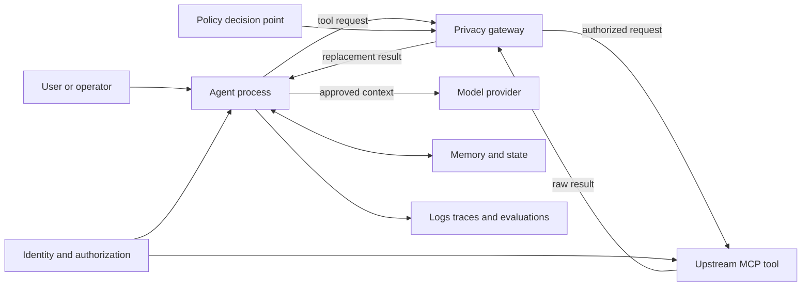

# Structured-Data Privacy Engineering for Deep Agents

**Record-Level Threats, MCP Result Minimization, and Reproducible Boundary Evidence**

Sandesh Bagmare

Independent Research and Engineering Demonstration

July 2026

## Abstract

Deep Agents can retrieve tables, JSON objects, typed models, nested arrays, dynamic
mappings, and aggregate query results through tools. Structured data is especially
valuable to an agent because field names, types, relationships, identifiers, and
repeated records support planning and downstream computation. The same structure also
creates privacy risk even when obvious values are redacted: schemas reveal sensitive
concepts, keys can contain data, arrays expose cardinality and membership, rare
categories enable singling out, and repeated aggregates support differencing. Once a
structured result enters agent state, it may propagate into model context, memory,
subagents, files, traces, or execution tools.

This paper develops a structured-data privacy model for Deep Agents and presents a
Model Context Protocol (MCP) gateway that minimizes tool results before they enter the
agent process. It distinguishes tabular record sets, nested objects, heterogeneous
collections, dynamic-key maps, typed Python objects, serialized JSON, aggregates, and
errors because each requires different disclosure controls. The reference
implementation uses a separate fail-closed FastMCP gateway. Under its default policy,
upstream results are replaced with schemas, inferred types, synthetic examples, and
privacy metadata; observed values, prose, errors, and unsupported content are
withheld. In a reproducible local experiment, five response classes containing
fourteen selected canaries were exercised. None appeared in gateway-visible safe
responses, and no external TCP connection was observed in the local stdio fixture.
These measurements establish a bounded result-boundary property, not anonymity, legal
compliance, universal confidentiality, or differential privacy. The paper provides a
detailed transformation model, field- and key-level threat analysis, aggregate
release controls, schema-governance requirements, Deep Agents propagation controls,
and structured-data release gates.

**Index Terms**—Deep Agents, structured data, data privacy, Model Context Protocol,
JSON, tabular data, schema privacy, data minimization, aggregate disclosure,
de-identification, differential privacy.

## I. Introduction

Deep Agents systems do more than generate text. They plan, call tools, query databases,
search files, create subagents, and retain state. Deep Agents combines a
LangGraph-based agent harness with tools, virtual filesystems, memory, context
management, subagents, human approval, and optional sandbox execution [1]. MCP
standardizes how clients discover and invoke tools and resources [2]. In enterprise
deployments, the information crossing these interfaces is commonly structured: SQL
rows, API JSON, customer objects, telemetry trees, financial transactions, device
inventories, support records, and analytical summaries.

Structured data needs separate treatment from prose. A table exposes a repeated
record model and population. A JSON object exposes paths and relationships. A mapping
may store personal data in keys rather than values. A typed model contributes semantic
field names. An aggregate carries information about a source population even though
no row is returned. Conventional pattern redaction cannot reliably protect these
representations because privacy depends on semantics, joins, rarity, and query
history, not only string shape.

The central engineering error is to reduce privacy to secrecy. Confidentiality asks
whether unauthorized parties can read data. Privacy additionally asks whether data
processing is lawful, fair, transparent, purpose-bound, proportionate, accurate,
retained only as necessary, contestable, and governable. A system may encrypt every
connection and still violate purpose limitation. It may redact names and still enable
linkage through quasi-identifiers. It may block raw rows and still reveal membership
through repeated aggregates. It may expose no source values to a model while retaining
identifiable traces indefinitely.

This paper makes five contributions:

1. A taxonomy of structured MCP results and their field-, key-, record-, collection-,
   schema-, and query-level disclosure channels.
2. A transformation model for converting authorized raw structures into agent-visible
   schemas, types, synthetic examples, approved aggregates, or withheld envelopes.
3. A Deep Agents propagation model covering model context, memory, subagents,
   filesystems, traces, and execution backends.
4. A fail-closed MCP gateway that moves result minimization ahead of the agent boundary.
5. A reproducible experiment and assurance argument that bound the demonstrated claim.

This work is an engineering research artifact, not legal advice, certification, or a
claim of compliance with any jurisdiction.

## II. Claim Taxonomy and Research Method

### A. Five claim classes

Privacy publications often overstate evidence by moving silently between different
types of authority. This paper labels claims according to the following classes.

| Class | Meaning | Example |
|---|---|---|
| Legal obligation | Binding only when applicable to the organization, processing, data subject, and jurisdiction | GDPR data minimization and data-subject rights [3] |
| Normative specification | A requirement for conformance to a selected protocol profile | MCP token audience validation and prohibition on token passthrough [4], [5] |
| Voluntary framework | Risk-management or engineering guidance adopted by choice or policy | NIST Privacy Framework and AI RMF [6], [7] |
| Measured property | An observation from a defined implementation, fixture, boundary, and test | Fourteen selected canaries absent from five tested safe responses |
| Recommendation | A deployment control derived from threats, obligations, and engineering judgment | Require policy approval for every raw-result passthrough tool |

A measured property must identify its system version, policy, input set, observation
point, and failure condition. A legal claim must identify applicable law and context.
A framework mapping is not certification. A passing canary test is not proof that no
semantic disclosure, inference, or future implementation defect exists.

### B. Source selection

The analysis prioritizes primary and authoritative sources: GDPR text published by
EUR-Lex [3]; NIST privacy, AI-risk, de-identification, and differential-privacy
publications [6]–[10]; official ISO standard descriptions [11]–[13]; MCP protocol and
security specifications [2], [4], [5]; official Deep Agents documentation [1]; and
public threat-modeling and secure-development guidance from LINDDUN, OWASP, MITRE,
and the UK National Cyber Security Centre (NCSC) [14]–[17]. Public ISO descriptions
are cited rather than reproducing copyrighted standard text.

### C. Research questions

The work addresses four questions:

- **RQ1:** Which properties of tables, JSON objects, typed records, dynamic maps, and
   aggregates disclose information to a Deep Agents runtime?
- **RQ2:** Which structural information can be retained for agent utility without
   forwarding observed source values?
- **RQ3:** Which technical boundary can minimize structured MCP results before they
   enter model context, memory, subagents, files, or traces?
- **RQ4:** What can a reproducible local experiment establish about that boundary, and
   which inference and governance risks remain?

## III. Privacy Foundations

### A. Personal data, pseudonymization, and identifiability

GDPR defines personal data broadly as information relating to an identified or
identifiable natural person [3]. Identifiability is contextual: names are not the only
identifiers. Device IDs, account references, location, combinations of attributes,
and linkable behavior can identify or single out a person. Pseudonymization separates
identity information from records but remains reversible when additional information
exists; pseudonymized data therefore remains personal data in the relevant GDPR
context [3].

De-identification is not a single transformation. NIST SP 800-188 treats it as a
combination of techniques and governance intended to prevent or limit disclosure
risk while retaining utility [9]. Direct-identifier removal does not address
quasi-identifier linkage, singling out, attribute inference, model memorization, or
auxiliary-data attacks. Synthetic data can also leak when generation memorizes source
records or preserves rare combinations too faithfully.

### B. Privacy principles

Article 5 of GDPR expresses a useful system-design baseline: lawfulness, fairness and
transparency; purpose limitation; data minimization; accuracy; storage limitation;
integrity and confidentiality; and accountability [3]. These principles imply
different controls:

| Principle | Agentic-system implication |
|---|---|
| Lawfulness, fairness, transparency | Record purpose and legal basis; disclose agent/tool/model roles and material automated effects |
| Purpose limitation | Bind tool access, memory use, and downstream disclosure to approved purposes |
| Data minimization | Limit tool arguments, source rows, returned fields, model context, logs, and retention |
| Accuracy | Track provenance, freshness, correction state, and derived-data uncertainty |
| Storage limitation | Apply per-artifact retention and verified deletion to prompts, traces, memory, caches, and backups |
| Integrity and confidentiality | Authenticate, authorize, isolate, encrypt, monitor, and handle incidents |
| Accountability | Maintain owners, processing records, decisions, tests, approvals, and audit evidence |

Privacy by design and by default requires these safeguards to be selected during
architecture, not added only after deployment [3]. The NIST Privacy Framework likewise
positions privacy as enterprise risk management for beneficial data processing [6].
NISTIR 8062 and the Privacy Risk Assessment Methodology connect system design and
problematic data actions to risks experienced by individuals [8].

### C. Rights and operational workflows

Where applicable, privacy rights must become executable workflows rather than policy
statements. Access requires locating data across prompts, tool stores, vector indexes,
memory, traces, evaluation corpora, and provider systems. Rectification requires
propagating corrections or marking derived artifacts stale. Erasure requires deleting
or irreversibly disassociating eligible data from primary stores, replicas, caches,
indexes, and scheduled training/evaluation sets. Restriction and objection require
enforcement flags at retrieval and processing time. Portability requires structured,
authenticated export. Automated-decision safeguards may require meaningful
information, contestability, and human review [3].

An agent that cannot discover where a subject's data propagated cannot reliably
execute these rights. Provenance and data lineage are therefore privacy controls.

## IV. System and Data-Flow Model

### A. Reference topology



The gateway is a privacy enforcement point, not the complete privacy program. Raw
authorized results exist in the source, upstream MCP server, and transiently in the
gateway process. Under validated schema-only paths, the gateway constructs a new
result before the agent process receives it. User prompts, tool names, descriptions,
argument schemas, field names, inferred types, synthetic examples, and policy metadata
may still cross the boundary.

### B. Data inventory

A production inventory should classify at least the following data classes:

1. User input, attachments, identity, tenancy, role, location, and consent state.
2. Tool descriptions, schemas, arguments, credentials, results, errors, and metadata.
3. Model prompts, responses, hidden state, safety annotations, and provider metadata.
4. Agent plans, scratch state, checkpoints, files, memory, and subagent messages.
5. Derived profiles, scores, embeddings, summaries, inferred attributes, and actions.
6. Logs, traces, metrics, feedback, evaluations, incident artifacts, and backups.
7. Policy decisions, approvals, rights requests, legal holds, and deletion evidence.

Each inventory entry needs an owner, data subjects, sensitivity, purpose, legal basis
where applicable, source, recipients, region, retention, deletion mechanism, access
policy, lineage, and approved uses. “Prompt data” is too broad to be governable.

### C. Agent-specific propagation

Agent autonomy increases privacy risk through four mechanisms. First, tool selection
can reveal intent and sensitive categories even when results are hidden. Second,
multi-step plans can join individually low-risk fields into identifying profiles.
Third, subagents and context offloading create additional copies and policy boundaries.
Fourth, execution tools can move data outside the controls applied to model context.
Deep Agents filesystem permissions do not automatically constrain arbitrary sandbox
execution, and declarative subagents require their own middleware restrictions [1].
Authorization and privacy policy must therefore propagate explicitly to every child,
backend, and execution surface.

## V. Structured-Data Privacy Model

### A. Structured result classes

The privacy decision must be based on representation and semantics rather than MIME
type alone. JSON can encode every class below, while an in-process tool can additionally
return dataclasses, Pydantic models, named tuples, sets, temporal values, decimals,
UUIDs, paths, enums, and binary values.

| Result class | Structural signal | Principal privacy risk | Safe default |
|---|---|---|---|
| Record set | Non-empty sequence of mappings or a configured row container | Row disclosure, membership, linkage, population size | Union schema, type sets, synthetic row; no values or count |
| Single record | Mapping of stable fields to scalars | Direct and quasi-identifiers, sensitive attributes | Recursive shape with synthetic scalars |
| Nested object | Mapping/array tree | Relationship, path, hierarchy, and embedded-record disclosure | Bounded recursive shape |
| Dynamic-key map | Values indexed by email, host, UUID, account, URL, or free text | Data escapes value-only redaction through keys | Replace non-schema keys with synthetic field names |
| Heterogeneous array | Collection whose elements have different shapes | Later elements introduce undisclosed fields or records | Merge or validate all item shapes; otherwise withhold |
| Typed object | Dataclass, Pydantic model, named tuple, enum, date, UUID, path | Type and field metadata reveal domain semantics | Normalize only documented structural protocols |
| Serialized structure | JSON encoded inside a text block | String policy bypasses structural controls | Parse, then apply the same structural policy |
| Aggregate result | Count, sum, mean, extrema, histogram, grouped statistic | Membership, rarity, differencing, reconstruction | Explicit policy, query history, suppression or formal PET |
| Error/metadata | Exception, stack, MCP metadata, resource or mixed block | Values, credentials, SQL, infrastructure, trace identifiers | Generic replacement; do not copy unsupported blocks |

An empty list is ambiguous: it may be an empty record set or an ordinary collection.
Its schema cannot be inferred from values. Production contracts should obtain schema
from an approved tool descriptor or registered policy rather than guessing. Likewise,
a record-set detector that recognizes only configured container names can miss
domain-specific wrappers such as `results`, `entities`, or `matches`; unrecognized
containers must still receive recursive value replacement and must not silently pass.

### B. Disclosure units

For a structured result $D$, privacy analysis should consider more than scalar values.
Define the observable disclosure surface as

$$
\mathcal{O}(D)=V(D)\cup K(D)\cup T(D)\cup C(D)\cup R(D)\cup Q(D)\cup M(D),
$$

where $V$ is observed values, $K$ keys and field names, $T$ types, $C$ cardinalities,
$R$ relationships and nesting, $Q$ query arguments/history, and $M$ metadata and
errors. A value-redaction function that protects only $V(D)$ leaves six other
disclosure channels.

The desired gateway transformation is a policy-dependent function

$$
G(D,P,A,H)\rightarrow S,
$$

where $P$ is purpose and privacy policy, $A$ is the requester's authorization context,
$H$ is relevant release history, and $S$ is the safe structured result. The reference
gateway currently evaluates result policy and tool name but does not independently
evaluate identity, tenant, purpose, or query history. Those inputs must be enforced by
the upstream system or an external policy decision point in production.

### C. Field names and schema privacy

Schema is data. Fields such as `hiv_status`, `union_membership`, `fraud_score`,
`termination_reason`, or `domestic_violence_case_id` reveal sensitive processing even
when every value is replaced. A table's field combination can fingerprint an internal
system or business process. Types can reveal precision, temporal behavior, identifier
formats, and likely joins. Optional/null patterns can reveal workflow state.

Schema release therefore needs a domain allowlist, aliases, purpose binding, and
version review. A robust policy classifies fields as:

- **public structural fields**, which may retain approved names and types;
- **aliased fields**, whose original semantic names remain inside the trust zone;
- **identifier fields**, whose values are always withheld and whose names may also
  require aliasing;
- **sensitive attributes**, whose existence, type, and nullability require approval;
- **derived fields**, which require provenance and inference review; and
- **unknown fields**, which fail closed until classified.

The reference implementation retains schema-like keys that match a conservative name
grammar and replaces value-like keys such as emails, IP addresses, UUID-shaped keys,
URLs, long tokens, and free-form strings. This protects common dynamic-key cases but
does not prove that every apparently stable key is harmless. For example, a short
username, medical code, hostname, or account alias can syntactically resemble a schema
name. Domain allowlisting is stronger than syntax alone.

### D. Record sets and identifier analysis

A record is not safe merely because direct identifiers are removed. Quasi-identifiers
such as age, postal code, date, role, location, device properties, and rare categories
can support linkage [9], [21]. Sensitive attributes can then be inferred from the
linked row. Record-order stability, exact timestamps, decimal precision, and unique
combinations further increase singling-out risk.

For schema-only release, the reference gateway computes the union of record keys and
the set of observed primitive types for each field, then generates a synthetic row
from policy rules. This retains shape without sampling a source row. It does not expose
row count by default. Identifier-like field values map to a fixed synthetic marker;
numeric values map to zero; booleans to false; and other fields to generated examples.
No observed value should seed the example.

Even this transformation requires care. A union schema can reveal a rare field that
occurs in one record. A type union such as `null|string` can reveal missingness. Schema
drift can disclose that a new sensitive workflow exists. Production systems should
prefer a reviewed declared output schema over data-dependent schema discovery, or
apply minimum support thresholds and suppress rare fields. Schema changes should
invalidate prior approval and trigger contract tests.

### E. Nested structures and collection semantics

Nested objects reveal relationships: a `patient` object containing `dependents`, a
`device` containing `location_history`, or an `employee` containing `investigations`
communicates sensitive facts through paths alone. Arrays add order, cardinality, and
membership. Maps reveal association between keys and values. Safe transformation must
therefore recurse through the entire graph while replacing every leaf and reviewing
every path.

The reference normalizer tracks object identity to stop cycles and withholds
structures beyond 32 levels. It recognizes explicit structural protocols rather than
reflecting arbitrary object attributes or rendering `repr()`, both of which may execute
application code or disclose values. Unknown and hostile structures fail closed.

The current generic shape function represents an ordinary array using its first
element's shape and omits length unless counts are enabled. This is privacy-preserving
with respect to later element values, but it can under-describe heterogeneous arrays.
A production policy should either validate homogeneity, compute a safely merged item
schema, use a registered schema, or mark the item shape as heterogeneous/withheld. It
must not forward later elements merely to improve agent utility.

### F. Dynamic keys and non-string keys

Many structured systems put data in keys:

```json
{
  "alice@example.test": {"balance": 400},
  "10.0.0.8": {"status": "critical"}
}
```

Sanitizing only values discloses the email and IP address. The gateway converts keys
to strings for structural handling, then retains only keys that look like stable
schema names; others become position-based synthetic names. This prevents common key
channels from reaching the agent. However, converting non-string keys can collapse
distinct values into the same textual key, and order-based synthetic labels should
not be treated as stable pseudonyms across releases. Production code should detect
collisions, cap key counts, and avoid persistent labels that permit longitudinal
linking.

### G. Aggregates, counts, and query composition

Counts reveal existence and can disclose membership when a filter targets one person.
Minimum, maximum, sum, and mean can reveal exact values in small cohorts. Group labels
can themselves be sensitive. Repeated queries can subtract overlapping populations:

$$
\operatorname{sum}(D)-\operatorname{sum}(D\setminus\{x\})=x.
$$

The 34-tool demonstration computes on 100 deterministic rows inside the MCP process,
returns no source rows, and suppresses numeric statistics for cohorts smaller than
five. The generic gateway keeps counts and aggregates disabled by default; when
enabled, it uses synthetic group labels and minimum-cohort suppression. Counts remain
intentional disclosures and cohort thresholds do not prevent differencing,
composition, auxiliary-data linkage, or repeated-query reconstruction.

A production aggregate service needs a query ledger keyed to requester, purpose,
dataset/version, filter, time window, and prior releases. Controls may include minimum
cohorts, contribution bounds, query-set approval, overlapping-cohort detection,
rounding, delayed release, rate limits, and formally evaluated differential privacy.
Privacy decisions must happen before the aggregate enters Deep Agents context, not in
the final natural-language answer.

### H. Deep Agents propagation after release

Once $S$ enters the Deep Agents process, it may be copied into the model prompt,
conversation state, context summaries, checkpoints, durable memory, subagent inputs,
filesystem artifacts, sandbox commands, traces, evaluations, and user-visible output.
The gateway reduces the sensitivity of one ingress path but does not govern these
copies. Each release should carry machine-readable labels including policy version,
source/tool identity, allowed purpose, sensitivity, retention, and whether aggregates
or passthrough were used.

Deep Agents deployments should apply the following structured-context rules:

1. Do not place raw structured tool results in checkpoints before gateway enforcement.
2. Preserve privacy labels when serializing state or summarizing context.
3. Give subagents only selected fields and attenuated tools, not the complete parent
   state; declarative subagents need their own middleware restrictions [1].
4. Treat filesystem writes, code interpreters, and sandbox commands as new structured
   data exports with destination policy and egress controls.
5. Configure tracing to record tool name, policy decision, schema version, and timing
   without recording arguments or result bodies by default.
6. Apply rights, retention, and deletion workflows to checkpoints, memory, vector
   indexes, files, traces, and evaluation datasets, not only chat transcripts.

## VI. Threat Model

### A. Protected interests and adversaries

Protected interests include confidentiality, freedom from unwanted observation,
control over use, fair treatment, autonomy, reputation, safety, and the ability to
exercise rights. Adversaries may be external attackers, malicious users, compromised
tools, overprivileged agents, insiders, providers, or accidental system behavior.
Threats can also arise without an adversary when legitimate processing is surprising,
excessive, inaccurate, or incompatible with the original purpose.

### B. LINDDUN analysis

LINDDUN provides seven privacy threat categories [14]:

| Category | Agentic example | Primary controls |
|---|---|---|
| Linking | Joining tool output, memory, and trace IDs across sessions | Purpose-bound identifiers, separation, aggregation, deletion |
| Identifying | Re-identifying a synthetic or pseudonymous record using auxiliary data | Disclosure review, quasi-identifier analysis, formal PETs |
| Non-repudiation | Permanent logs proving sensitive user actions | Proportionate audit design, access control, retention limits |
| Detecting | Inferring that a person or rare condition exists from tool behavior | Uniform errors, query controls, thresholding, privacy budgets |
| Data disclosure | Raw rows, secrets, errors, or files entering agent/model context | Gateway minimization, authorization, DLP, isolation |
| Unawareness | Users do not know tools, providers, retention, or automated effects | Layered notices, consent/choice records, user controls |
| Non-compliance | Processing lacks purpose, basis, rights support, or transfer controls | Governance, records, DPIAs, contracts, audits |

LINDDUN complements rather than replaces security threat modeling. OWASP identifies
LLM risks such as prompt injection, sensitive-information disclosure, excessive
agency, and supply-chain weaknesses [15]. MITRE ATLAS includes prompt injection,
context poisoning, tool poisoning, malicious tool invocation, RAG poisoning, and
escape to host [16]. A poisoned tool can manipulate the agent and exfiltrate data even
when its original business purpose is legitimate.

### C. Protocol and authorization threats

MCP authorization guidance prohibits token passthrough and requires servers to
validate that tokens are intended for them [4], [5]. For HTTP transports, resource
indicators, audience validation, PKCE, exact redirect matching, secure token storage,
and protected-resource metadata reduce confused-deputy and token-theft risks [4],
[5]. Tokens must not appear in URI query strings. Servers must authorize every inbound
request; session identifiers are not authentication [4]. Stdio deployments should
obtain credentials from the environment rather than transplanting an HTTP OAuth flow
[5].

Additional threats include SSRF during authorization metadata discovery, session
hijacking, malicious authorization URLs, DNS rebinding, local MCP compromise, and
scope inflation [4]. Privacy depends on these security properties because an attacker
who bypasses source authorization can cause otherwise correct minimization logic to
process data the requester was never entitled to access.

## VII. Lifecycle Privacy Control Model

### A. Governance and purpose

Before implementation, the organization should document the processing purpose,
affected people, expected benefit, necessity, proportionality, legal basis where
applicable, prohibited uses, risk owners, and exit criteria. High-risk processing may
require a data-protection impact assessment (DPIA) under applicable law [3]. ISO/IEC
42001 describes an AI management system with risk management, transparency,
traceability, and continual improvement [11]; ISO/IEC 27001 provides the surrounding
information-security management structure [12]. Neither mapping alone establishes
certification or compliance.

Consent, when used, must be demonstrable, specific to relevant purposes, and as easy
to withdraw as to give under applicable requirements. ISO/IEC TS 27560 defines an
interoperable structure for consent records and receipts across the consent lifecycle
[13]. Consent should not be treated as a universal substitute for necessity,
fairness, or another appropriate legal basis.

### B. Collection and tool invocation

Minimization begins before results are returned. Tool arguments can contain complete
documents, identity attributes, secrets, or broad date ranges. Controls should:

- expose only required tools and arguments to the model;
- validate purpose, identity, tenant, role, and record scope upstream;
- use field projection, row filters, bounded time ranges, and result limits;
- prevent credentials and policy attributes from becoming model-generated arguments;
- require approval for sensitive actions and irreversible effects;
- reject requests whose purpose or authority cannot be established; and
- record policy decisions without copying sensitive payloads into audit logs.

### C. Processing and derivation

Local processing should prefer the least revealing computation that answers the
question. Counts, aggregates, classifications, and summaries remain disclosures and
must be assessed for inference, rare groups, differencing, and repeated-query attacks.
Contribution bounding, query auditing, rate limits, overlap analysis, and release
review may be required.

The minimum-cohort rule can be expressed as

$$
R(D,q)=
\begin{cases}
f(D_q), & |D_q| \ge k,\\
\bot, & |D_q| < k,
\end{cases}
$$

where $D_q$ is the matching cohort, $f$ is an approved statistic, $k$ is a policy
threshold, and $\bot$ denotes suppression. This reduces direct small-group release but
does not prevent composition or differencing. It is not differential privacy.

### D. Differential privacy

A randomized mechanism $M$ satisfies $(\epsilon,\delta)$-differential privacy when,
for adjacent datasets $D$ and $D'$ and measurable output set $S$,

$$
\Pr[M(D)\in S] \le e^{\epsilon}\Pr[M(D')\in S] + \delta.
$$

A valid claim requires an explicit adjacency definition, mechanism, sensitivity or
contribution bounds, parameters, composition accountant, implementation evaluation,
and policy for privacy-budget exhaustion. NIST SP 800-226 provides guidance for
evaluating such guarantees and the promises they do and do not support [10]. The
reference gateway does not implement this mechanism and makes no differential-privacy
claim.

### E. Model context, memory, and subagents

Every context copy is a disclosure surface. Controls should separate user-visible
conversation, model context, hidden planning state, durable memory, and evaluation
records. Sensitive context should be labeled, minimized before summarization, and
subject to recipient and retention policy. Summarization is not deletion; a summary
can retain sensitive facts. Embeddings are not automatically anonymous. Memory
retrieval must enforce current identity, tenant, purpose, consent/objection, and
deletion state.

Subagents should receive attenuated capabilities and minimum necessary context. The
parent's tool allowlist, middleware, credentials, and filesystem policy must not be
assumed to transfer automatically. Delegation records should identify policy version,
context classes, tools, and recipient without persisting raw content unnecessarily.

### F. Observability and evaluation

Logs and traces are frequently the largest uncontrolled privacy store. Default
telemetry should exclude raw prompts, tool arguments, results, authorization headers,
cookies, attachments, and exception details. Where content capture is necessary, use
sampling, field-level controls, short retention, restricted access, regional storage,
and a documented purpose. Debug modes need expiration and production guardrails.

Evaluation datasets require provenance, permission, minimization, representative risk
analysis, retention, and deletion workflows. A production trace should not silently
become a benchmark or fine-tuning record. Privacy testing should include canaries,
semantic leakage review, inference attacks, poisoned tools, hostile errors, cross-
tenant attempts, rights-request drills, and deletion verification.

### G. Retention, deletion, and incident response

Retention must be artifact-specific and event-driven. Conversation state, gateway
memory, caches, traces, evaluation sets, backups, and provider copies may need
different schedules. Deletion evidence should show scope, completion, exceptions,
replica handling, and legal holds. Cryptographic erasure can support deletion where
appropriate but requires disciplined key separation and lifecycle management.

Privacy incidents include unauthorized access and also unintended purpose expansion,
incorrect automated decisions, failed deletion, unapproved provider use, or revealing
aggregates. Runbooks should support containment, evidence preservation without further
exposure, risk assessment, notification where required, credential rotation, policy
rollback, affected-person communication, and lessons learned. GDPR includes breach
notification and communication duties when its conditions apply [3].

## VIII. Fail-Closed MCP Privacy Gateway

### A. Design objective

The reference implementation controls one boundary: successful and failed tool
results traveling from an upstream MCP server into the agent process. A separate
FastMCP gateway receives the authorized upstream result and constructs a replacement
`ToolResult`. Client-side redaction inside the agent would be too late because raw
values would already have crossed the process boundary.

### B. Policy behavior

The default schema-only policy performs structural normalization and emits field
names, inferred types, synthetic scalars, and privacy metadata. It parses JSON text
before sanitization; handles mappings, collections, dataclasses, Pydantic models,
temporal values, decimals, UUIDs, paths, enums, binary values, cycles, and bounded
nesting; and keeps unknown objects opaque. Arbitrary prose, unsupported MCP blocks,
and upstream error details are replaced rather than copied.

Observed field values are not used as synthetic examples. Identifier-like fields are
marked withheld, and value-like mapping keys are replaced. Counts and aggregates are
disabled by default. Optional aggregate mode applies minimum-cohort suppression and
synthetic category labels, but retains the limitations described in Section VI-D.

### C. Explicit disclosure paths

Exact-name and wildcard passthrough can forward complete successful results. This is
not a weaker sanitization mode; it is an intentional removal of the result-minimizing
boundary for matching tools. It requires upstream authorization, data-owner approval,
provider review, logging controls, neighboring-tool tests, expiry, and schema/catalog
change detection. Errors remain generic. Wildcard approval must apply to the entire
server catalog and fail deployment when new tools appear without renewed review.

### D. Failure semantics

A privacy boundary must fail closed when parsing, traversal, sanitizer callbacks, or
upstream execution fail. Error messages commonly contain credentials, hostnames,
queries, record values, or stack state. The implementation therefore returns a
generic private error and does not rely on model instructions to ignore sensitive
content. Availability degradation is preferred to silent disclosure.

## IX. Experiment and Results

### A. Experimental setup

The evidence harness launches a real gateway process and a deliberately sensitive
upstream fixture as descendants. Communication uses MCP JSON-RPC over stdio. The
harness exercises five response classes: tabular customer rows, infrastructure state,
nested dynamic keys, private prose, and an upstream failure. Fourteen selected
canaries are distributed across values, keys, text, and error details. The harness
observes serialized gateway responses and, on Windows, captures TCP entries owned by
the gateway process tree. It makes no model request and requires no API key.

Let $C$ be the selected canary set and $Y_i$ a serialized safe response. The measured
failure predicate is

$$
L = \bigvee_i \bigvee_{c\in C} [c \subseteq Y_i].
$$

The run passes the selected-value check when $L=0$. This predicate detects exact
selected markers, not paraphrases, derived facts, encodings not included in the scan,
or unknown sensitive values.

### B. Captured observations

| Measure | Observation |
|---|---:|
| Response classes exercised | 5 |
| Selected canaries tested | 14 |
| Selected canaries blocked | 14 |
| Selected canary matches in safe responses | 0 |
| Process-tree TCP entries observed | 6 |
| Loopback/runtime TCP entries | 6 |
| External TCP connections observed | 0 |
| Raw fixture bytes | 1,743 |
| Safe response bytes | 1,614 |
| Aggregate byte reduction | 7.4% |

Byte reduction is not a privacy metric. Structural metadata can exceed the size of a
small input while disclosing fewer observed values. The relevant result is the absence
of selected canaries at the defined observation boundary. The zero-external-network
observation applies only to the local stdio fixture and does not imply that a deployed
agent, HTTP MCP server, telemetry service, or model provider makes no network request.

### C. Interpretation

The experiment supports this bounded claim: for the tested implementation, policy,
response classes, fixture values, and gateway-to-client observation point, none of the
fourteen selected canaries appeared in the replacement MCP responses. It also shows
that the fixture used local stdio and produced no observed external TCP connection in
the inspected process tree during capture.

The experiment does not establish:

- that raw data never exists;
- resistance to all encodings, side channels, semantic inference, or compromised code;
- anonymity, de-identification sufficiency, or differential privacy;
- authorization, tenant isolation, lawful basis, fairness, or rights compliance;
- privacy of user prompts, field names, tool metadata, or approved aggregates;
- model-provider, telemetry, backup, or downstream-recipient behavior; or
- correctness under future versions, policies, tools, and schemas.

## X. Deployment Control Catalog

The following catalog defines minimum control objectives; implementation strength
must scale with sensitivity, autonomy, affected people, and consequence.

| Domain | Required control objective | Evidence |
|---|---|---|
| Governance | Approved purpose, basis, prohibited uses, owners, and review cadence | Processing record, risk decision, DPIA where applicable |
| Inventory | End-to-end data and model/tool lineage | Data map, recipient list, regional flow diagram |
| Identity | Strong user, workload, tool, and administrator identity | Authentication configuration and access review |
| Authorization | Per-request, tenant-aware, purpose-appropriate least privilege | Policy tests, denied-request tests, decision logs |
| MCP security | Audience-bound tokens, no token passthrough, PKCE/redirect/SSRF controls as applicable | Protocol conformance and penetration tests |
| Minimization | Narrow arguments, projections, bounded results, schema-only default | Contract tests and payload inspection |
| Schema governance | Approved field names, aliases, types, nullability, versions, and drift response | Versioned schema registry and change review |
| Structural transformation | Full-tree leaf replacement, dynamic-key handling, cycle/depth bounds, hostile-object failure | Property tests across supported data classes |
| Disclosure | Reviewed aggregates, synthetic data, exports, and passthrough | Disclosure assessment, approvals, budget/accounting where used |
| Query composition | Requester/purpose-aware aggregate ledger and overlapping-query controls | Query-history tests and reconstruction exercises |
| Agent capabilities | Tool, filesystem, network, execution, memory, and subagent restrictions | Capability manifest and adversarial tests |
| State propagation | Labels and minimization preserved through prompts, checkpoints, summaries, memory, and subagents | End-to-end lineage and state inspection |
| Provider governance | Purpose, retention, training, region, subprocessors, deletion, incidents | Contract and configuration evidence |
| Observability | Content-minimized logs and traces with restricted access and retention | Telemetry schema and sampled production review |
| Rights | Discover, access, correct, restrict, export, object, and erase where applicable | Workflow tests and completion records |
| Retention | Artifact-specific schedules, legal holds, replicas, verified deletion | Retention map and deletion drills |
| Security | Isolation, encryption, key/secrets management, patching, supply-chain controls | ISMS controls, scans, SBOM, recovery tests |
| Incident response | Privacy-aware detection, containment, assessment, notification, recovery | Exercised runbooks and post-incident review |
| Assurance | Versioned claims, tests, residual risks, independent review | Release assurance case and signed decision |

### A. Release gates

A production release should fail when any of the following is unresolved:

1. An MCP connection bypasses the approved gateway or equivalent enforcement point.
2. A tool, subagent, execution backend, provider, or data recipient lacks an owner.
3. Authorization is inferred from possession of an MCP session identifier.
4. Raw payload logging is enabled without a documented, time-bounded exception.
5. Passthrough or aggregate release lacks current approval and regression tests.
6. Tool catalog or schema changes invalidate the disclosure assessment.
7. Rights and deletion workflows cannot locate the system's copies and derivatives.
8. Canary, cross-tenant, hostile-error, prompt-injection, or policy tests fail.
9. Residual privacy risk exceeds the accepting authority's documented threshold.
10. An unclassified field, dynamic key, heterogeneous collection, or schema drift can
   enter agent-visible state.
11. Aggregate release history cannot be evaluated for differencing or composition.

### B. Assurance case

An assurance case should connect each claim to evidence and explicitly state
assumptions and defeaters:

| Claim | Evidence | Assumption | Defeater |
|---|---|---|---|
| Tested raw canaries do not cross the result boundary | Process test and captured MCP responses | All relevant paths route through gateway | Direct client connection bypasses gateway |
| Tool executes on complete authorized data | Dual-perspective upstream/client test | Fixture represents intended execution sequence | Alternate tool path serializes rows directly |
| Errors fail closed | Hostile upstream error tests | All exceptions pass through middleware | Framework change emits error before middleware |
| No external TCP connection in fixture | Process-tree socket capture | Capture sees relevant processes and interval | Child escapes process tree or connection occurs outside interval |
| Production processing is acceptable | Legal, privacy, security, and business approvals | Deployment matches reviewed architecture | Purpose, provider, data, capability, or jurisdiction changes |

## XI. Discussion

### A. Utility and privacy

Schema-only output supports tool discovery, planning, and shape-aware reasoning but
cannot answer row-level questions. This is an intentional capability boundary. Where
business value requires detailed data, the design should seek a task-specific release:
perform the computation inside the trusted zone, disclose only the necessary result,
and evaluate inference. Raw passthrough should be exceptional, not the default answer
to utility pressure.

### B. Performance and operational cost

The gateway adds process, serialization, parsing, and transformation overhead. Deep
Agents can also add context, checkpoint, subagent, filesystem, and model-call costs.
No universal CPU or RAM figure is defensible because payload shape, concurrency,
transport, model, fan-out, and backend dominate resource use. Deployments should
measure peak resident memory, CPU time, serialized state, open processes/descriptors,
queue time, gateway/tool/model latency, token use, subagent fan-out, and per-run cost
at representative concurrency. Privacy controls should be included in capacity and
failure testing rather than disabled under load.

### C. Security is necessary but insufficient

NCSC guidance organizes secure AI development into secure design, development,
deployment, and operation/maintenance [17]. Those practices protect the privacy
control plane, but a secure system can still perform excessive or unfair processing.
Conversely, a well-intentioned privacy policy fails if prompt injection, compromised
tools, weak authorization, or leaked tokens bypass it. Privacy engineering and secure
AI development must share architecture, testing, incident response, and ownership
while retaining distinct objectives.

## XII. Limitations and Threats to Validity

The implementation is a reference demonstration, not an independently audited DLP
product. The experiment uses deterministic synthetic fixtures and exact canaries. Its
five response classes do not enumerate every MCP content type, implementation defect,
serialization form, covert channel, or domain-specific disclosure. Socket inspection
is platform- and interval-dependent. A compromised gateway can observe raw values in
memory. Field names, key paths, type unions, missingness, schemas, query arguments, and
result timing may themselves be sensitive. Generic identifier detection is lexical
and cannot recognize every domain identifier. Ordinary arrays currently expose only
the first element's generalized shape, and schema discovery is data-dependent.
Synthetic examples can be misleading or unsafe if produced from source records.
Minimum cohorts do not stop composition. Policy callbacks and passthrough intentionally
expand disclosure.

The legal discussion is necessarily general. Applicability varies by role,
jurisdiction, sector, data type, contractual context, and use. Public summaries of ISO
standards do not substitute for licensed standards or conformity assessment. Threat
taxonomies evolve, as do MCP, agent frameworks, models, providers, and attacks.

## XIII. Future Research

Future work should evaluate semantic leakage rather than exact strings; formally
verify middleware coverage across success, error, streaming, resource, and mixed-
content paths; bind policy to cryptographically identified tool manifests; propagate
purpose and data labels through subagents; and test capability attenuation across
filesystems, sandboxes, interpreters, and network egress. Aggregate mode should be
extended only with a defined disclosure model, contribution limits, composition
accounting, and independently evaluated differential-privacy mechanisms.

Structured-data research should also develop privacy-aware schema algebra: safely
merging heterogeneous arrays, suppressing rare fields, representing missingness
without leaking cohort properties, detecting key collisions, and proving that every
source leaf maps only to an approved synthetic or derived release. Stateful testing
should search for disclosures across sequences of tool calls rather than treating each
response independently. Agent benchmarks should include cross-tool joins, schema
fingerprinting, dynamic-key attacks, aggregate reconstruction, context summarization,
checkpoint replay, and subagent delegation.

Additional priorities include machine-readable consent and purpose receipts,
rights-aware vector retrieval, deletion verification across derived artifacts,
privacy-preserving telemetry, confidential computing for gateway memory, provider-
independent evidence formats, and benchmarks that jointly measure privacy risk,
utility, latency, memory, and cost. Longitudinal research should study whether agents
combine harmless fragments into sensitive inferences across sessions and tools.

## XIV. Conclusion

Structured-data privacy in Deep Agents cannot be delegated to a prompt, value-redaction
regex, model provider, or transport protocol. Protection must cover values, field
names, keys, types, cardinalities, relationships, query history, metadata, and every
place an agent can propagate the released structure. It also requires governance over
why data is processed, what enters each tool, which computation occurs, where context
persists, who can retrieve it, how people exercise rights, and how evidence supports
bounded claims.

The MCP privacy gateway demonstrates one useful architectural pattern: process
complete authorized data inside a constrained upstream trust zone, then construct a
new fail-closed result before the agent can observe raw tool output. The measured
experiment supports that narrow boundary claim for selected fixtures and paths. It
does not erase the need for authorization, purpose limitation, de-identification
analysis, formal privacy mechanisms, provider governance, secure development,
retention, deletion, incident response, and accountability. A trustworthy deployment
is therefore not a filter plus an agent. It is a maintained privacy management system
whose claims, controls, evidence, owners, and residual risks remain aligned as the
agent's capabilities and data flows change.

## References

[1] LangChain, “Deep Agents overview,” *LangChain Documentation*. [Online].
Available: https://docs.langchain.com/oss/python/deepagents/overview. Accessed: Jul.
19, 2026.

[2] Model Context Protocol, “Specification,” 2025. [Online]. Available:
https://modelcontextprotocol.io/specification/2025-06-18. Accessed: Jul. 19, 2026.

[3] European Parliament and Council of the European Union, “Regulation (EU) 2016/679
(General Data Protection Regulation),” *Official Journal of the European Union*, Apr.
27, 2016. [Online]. Available: https://eur-lex.europa.eu/eli/reg/2016/679/oj.

[4] Model Context Protocol, “Security best practices,” Jun. 18, 2025. [Online].
Available:
https://modelcontextprotocol.io/specification/2025-06-18/basic/security_best_practices.
Accessed: Jul. 19, 2026.

[5] Model Context Protocol, “Authorization,” Jun. 18, 2025. [Online]. Available:
https://modelcontextprotocol.io/specification/2025-06-18/basic/authorization.
Accessed: Jul. 19, 2026.

[6] National Institute of Standards and Technology, *NIST Privacy Framework: A Tool
for Improving Privacy through Enterprise Risk Management, Version 1.0*, Jan. 2020.
[Online]. Available: https://www.nist.gov/privacy-framework.

[7] National Institute of Standards and Technology, *Artificial Intelligence Risk
Management Framework (AI RMF 1.0)*, NIST AI 100-1, Jan. 2023, doi:
10.6028/NIST.AI.100-1.

[8] S. Brooks, M. Garcia, N. Lefkovitz, S. Lightman, and E. Nadeau, *An Introduction
to Privacy Engineering and Risk Management in Federal Systems*, NISTIR 8062, Jan.
2017, doi: 10.6028/NIST.IR.8062.

[9] S. Garfinkel, B. Guttman, J. Near, A. Dajani, and P. Singer, *De-Identifying
Government Datasets: Techniques and Governance*, NIST SP 800-188, Sep. 2023, doi:
10.6028/NIST.SP.800-188.

[10] National Institute of Standards and Technology, *Guidelines for Evaluating
Differential Privacy Guarantees*, NIST SP 800-226, Mar. 2025, doi:
10.6028/NIST.SP.800-226.

[11] International Organization for Standardization, “ISO/IEC 42001:2023 Information
technology—Artificial intelligence—Management system,” Dec. 2023. [Online].
Available: https://www.iso.org/standard/81230.html.

[12] International Organization for Standardization, “ISO/IEC 27001:2022 Information
security management systems,” Oct. 2022. [Online]. Available:
https://www.iso.org/standard/27001.

[13] International Organization for Standardization, “ISO/IEC TS 27560:2023 Privacy
technologies—Consent record information structure,” 2023. [Online]. Available:
https://www.iso.org/standard/80392.html.

[14] LINDDUN, “LINDDUN privacy threat modeling.” [Online]. Available:
https://www.linddun.org/. Accessed: Jul. 19, 2026.

[15] OWASP Foundation, “OWASP GenAI Security Project.” [Online]. Available:
https://genai.owasp.org/. Accessed: Jul. 19, 2026.

[16] MITRE, “Adversarial Threat Landscape for Artificial-Intelligence Systems
(ATLAS).” [Online]. Available: https://atlas.mitre.org/. Accessed: Jul. 19, 2026.

[17] UK National Cyber Security Centre, *Guidelines for Secure AI System Development*,
version 1.0, Nov. 27, 2023. [Online]. Available:
https://www.ncsc.gov.uk/collection/guidelines-secure-ai-system-development.

[18] National Institute of Standards and Technology, *Artificial Intelligence Risk
Management Framework: Generative Artificial Intelligence Profile*, NIST AI 600-1,
Jul. 2024, doi: 10.6028/NIST.AI.600-1.

[19] A. Cavoukian, “Privacy by Design: The 7 Foundational Principles,” Information and
Privacy Commissioner of Ontario, 2009. [Online]. Available:
https://www.ipc.on.ca/sites/default/files/legacy/2018/01/pbd.pdf.

[20] C. Dwork and A. Roth, *The Algorithmic Foundations of Differential Privacy*.
Hanover, MA, USA: Now Publishers, 2014, doi: 10.1561/0400000042.

[21] A. Narayanan and V. Shmatikov, “Robust de-anonymization of large sparse datasets,”
in *Proc. IEEE Symp. Security and Privacy*, 2008, pp. 111–125, doi:
10.1109/SP.2008.33.

[22] M. Fredrikson, S. Jha, and T. Ristenpart, “Model inversion attacks that exploit
confidence information and basic countermeasures,” in *Proc. 22nd ACM SIGSAC Conf.
Computer and Communications Security*, 2015, pp. 1322–1333, doi:
10.1145/2810103.2813677.

[23] R. Shokri, M. Stronati, C. Song, and V. Shmatikov, “Membership inference attacks
against machine learning models,” in *Proc. IEEE Symp. Security and Privacy*, 2017,
pp. 3–18, doi: 10.1109/SP.2017.41.

[24] National Institute of Standards and Technology, “Privacy Engineering Program
resources.” [Online]. Available:
https://www.nist.gov/itl/applied-cybersecurity/privacy-engineering/resources.
Accessed: Jul. 19, 2026.

[25] National Institute of Standards and Technology, *Secure Software Development
Framework (SSDF) Version 1.1*, NIST SP 800-218, Feb. 2022, doi:
10.6028/NIST.SP.800-218.

## Appendix A: Privacy Review Worksheet

| Question | Required answer |
|---|---|
| What exact outcome is the processing intended to achieve? | Specific purpose and measurable benefit |
| Whose data is processed and who may be affected? | Subjects, bystanders, groups, and vulnerable populations |
| What is the authority or legal basis? | Jurisdiction-specific documented analysis |
| Why is each data field necessary? | Field-level necessity and alternative considered |
| Which tools, agents, models, providers, and people receive data? | Complete recipient and subprocessor map |
| What new data is inferred or derived? | Profiles, scores, embeddings, summaries, and actions |
| Which rights and choices apply? | Notice, access, correction, restriction, objection, export, erasure |
| How long does every artifact persist? | Per-store schedule, backups, holds, deletion method |
| What could harm people even without a breach? | LINDDUN and contextual privacy analysis |
| What evidence supports each privacy claim? | Test, review, contract, audit, or formal guarantee |
| What remains uncertain? | Residual risk, assumptions, monitoring, and accepting owner |

## Appendix B: Repository Reproduction

From the repository root on Windows:

```powershell
.\RUN_DEMO.cmd
.venv\Scripts\python.exe -m pytest -q
.venv\Scripts\python.exe -m compileall -q src tests scripts
.venv\Scripts\python.exe -m pip check
.venv\Scripts\python.exe -m build
```

The generated evidence is stored in `docs/assets/gateway-evidence.json`,
`docs/assets/gateway-network.log`, and `docs/assets/privacy-evidence.html`. Re-running
the capture changes timestamps, process identifiers, and ephemeral ports. Review the
machine-readable artifact together with the test suite and source; a screenshot alone
is not sufficient assurance.