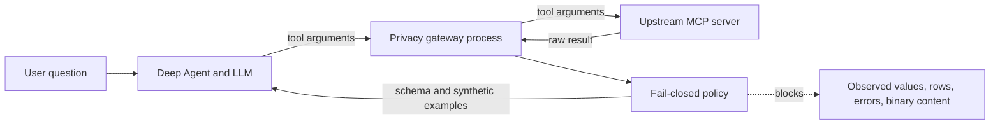

# Privacy Gateway Architecture

The Confluence-ready adoption proposal and current reproducible evidence package are
documented in [confluence-proposal.md](confluence-proposal.md).

## Goal

The reusable gateway prevents raw MCP tool results from entering the Deep Agent
process. Its default contract exposes only tool metadata, field names, type shapes,
and synthetic examples. The bundled analytics server is a separate demonstration that
can explicitly permit cohort-protected aggregates.

## Architecture



`create_private_mcp_client()` rewrites each upstream connection to launch the library's
stdio gateway. FastMCP proxies the tool catalog and calls the upstream server from that
child process. Middleware discards the upstream `ToolResult` and constructs a new safe
result before LangChain or Deep Agents receive it.

For stdio upstreams, both hops use local child-process pipes. HTTP upstreams remain
remote, but their responses terminate in the gateway process. The separate Deep Agent
process later sends the user question and safe result to the configured model over
HTTPS. Raw results necessarily exist in the upstream and gateway processes; they do
not cross the gateway-to-agent MCP boundary.

The middleware fails closed. Upstream errors and sanitizer exceptions become a generic
error, plain text is withheld unless a named policy hook handles it, and non-text MCP
blocks are not copied into the replacement result.

## Policy modes

| Mode | Configuration | Successful tool result | Error result |
|---|---|---|---|
| Schema-only | Default | Replacement structural envelope | Generic private error |
| Aggregate | `expose_counts=True`, `expose_aggregates=True` | Approved cohort-safe statistics | Generic private error |
| Selected raw | `passthrough_tools=("tool_name",)` | Original `ToolResult` for named tools | Generic private error |
| All raw | `passthrough_tools=("*",)` | Original `ToolResult` for every tool | Generic private error |

The passthrough decision is made in middleware after a successful upstream call and
before structural sanitization. Exact tool names form the allowlist; `*` is the only
wildcard. Unlisted tools follow the normal privacy policy. The original result includes
all MCP content blocks, structured content, and metadata, so passthrough is an explicit
trust-boundary bypass rather than a weaker sanitizer.

For mixed deployments, prefer a short selected-tool allowlist:

```python
client = create_private_mcp_client(
  connections,
  passthrough_tools=("get_public_catalog",),
)
```

Use `passthrough_tools=("*",)` only when every tool on every wrapped connection is
approved for agent and model disclosure. Errors remain fail-closed in both cases.

## Default data handling

- Record collections become column names, inferred types, and one synthetic row.
- Structured objects become recursive shapes with synthetic scalar values.
- JSON strings are parsed before structural sanitization.
- Common Python models and containers are normalized before shape extraction.
- Cycles and structures deeper than 32 levels become withheld reference markers.
- Plain prose is withheld by default.
- Identifier-like fields are marked withheld.
- Data-like mapping keys are replaced with synthetic field names.
- Counts and aggregates require explicit opt-in.
- Raw successful results require an exact tool-name or wildcard passthrough opt-in.

Normalization intentionally recognizes explicit structural protocols: mappings,
sequences, sets, dataclasses, Pydantic `model_dump()`, and named tuple `_asdict()`.
It does not inspect arbitrary object attributes or `repr()` output because those paths
can execute application code or disclose values. Unknown values are represented only
by a type name and synthetic scalar; traversal failures return a generic withheld
envelope.

## Transport evidence


Run the evidence capture directly:

```powershell
.venv\Scripts\python.exe scripts\capture-privacy-evidence.py
```

The script opens a real MCP JSON-RPC session through the gateway's stdin/stdout and
launches a deliberately sensitive upstream fixture as a descendant process. It calls
five response classes, checks 14 selected canary values, and inspects the complete
observed process tree with `Get-NetTCPConnection` on Windows.

The captured run records six local Python runtime loopback entries and zero external
connections. The zero-external observation is scoped to the local stdio fixture and
does not claim that a Deep Agent makes no model request. HTTP MCP upstreams and model
providers create expected network traffic in their respective processes. The evidence
harness itself makes no model request and requires no API key.

## What the LLM receives

Each of the 34 tools returns only:

- `privacy`: an explicit statement that raw rows were not shared.
- `schema`: column names, valid categories/statuses, and the numeric metric.
- `example_row`: one hard-coded synthetic record using `EXAMPLE-0000` and
  `YYYY-MM-DD`; it is never copied from the dataset.
- `query`: the operation actually executed.
- `result`: a count or aggregate computed inside the MCP process.

The synthetic example teaches the model the shape and meaning of the data without
revealing a real row.

## Supported questions

All 34 domain tools support these operations:

| Operation | Answer produced |
| --- | --- |
| `overview` | Count, sum, average, minimum, maximum, category counts, status counts |
| `count` | Number of matching records |
| `sum` | Sum of the domain's numeric metric |
| `average` | Average numeric metric |
| `minimum` | Minimum numeric metric |
| `maximum` | Maximum numeric metric |
| `group_count` | Counts grouped by category, status, or date |
| `group_sum` | Sums grouped by category, status, or date |
| `group_average` | Averages grouped by category, status, or date |

Optional exact-match filtering is available for `category`, `status`, and `date`.
The model can therefore answer questions such as:

- "How many products are backordered?"
- "What is average product price by category?"
- "Which sales region has the highest average revenue?"
- "Compare active and cancelled subscription counts."
- "Give an overview of support tickets."

It intentionally cannot answer row-level questions such as "What is the name of the
most expensive customer?" because answering would disclose a source record.

## Small-cohort protection

Removing rows alone is insufficient. A filter matching one person followed by an
average query could reveal that person's value. The server therefore suppresses
numeric results when fewer than five rows match. Counts remain available, but sums,
averages, minima, maxima, and overviews return a suppression response.

This is a demonstration privacy control, not a full differential-privacy system.
Repeated and overlapping aggregate queries can still enable inference attacks in a
real dataset. Production systems should add authorization, query auditing, rate
limits, contribution bounds, and differential privacy where required.

## Why an interceptor is not enough

An MCP client interceptor could redact a result after receiving it, but then raw data
would already have crossed into the agent process. Here, aggregation happens inside
the MCP server and the server never serializes raw rows into the protocol response.
The system prompt is defense in depth; the server response contract is the primary
control.

## OpenAI-compatible model configuration

Keep credentials in `.env`, which is excluded by `.gitignore`. For an
OpenAI-compatible provider:

```dotenv
MODEL=openai:your-model-name
OPENAI_API_KEY=replace-with-a-new-key
OPENAI_BASE_URL=https://provider.example/v1
```

Do not commit `.env`. If a key has been pasted into chat, logs, an issue, or source
control, revoke it and create a new one before use.

For the demonstrated OpenAI-compatible endpoint, configure it without putting the key
on the command line:

```powershell
.\scripts\configure-provider.ps1 -BaseUrl "https://jianzhile.vip/v1"
```

## Verification

Run:

```powershell
.venv\Scripts\python.exe -m pytest -q
.venv\Scripts\python.exe -m deepagents_mcp_demo.smoke
```

The tests compare source rows against the public analysis response, assert that no
source ID or source name is present, verify deterministic grouped answers, and check
small-cohort suppression. The smoke test exercises the same contract across a real
stdio MCP session and fails if a `rows` field reaches the client.